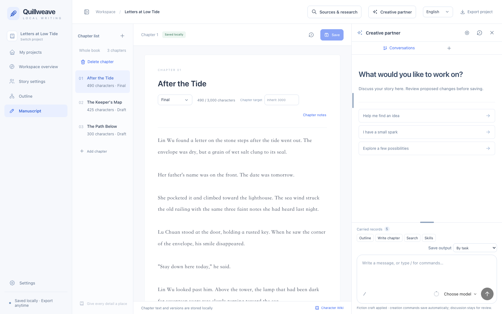
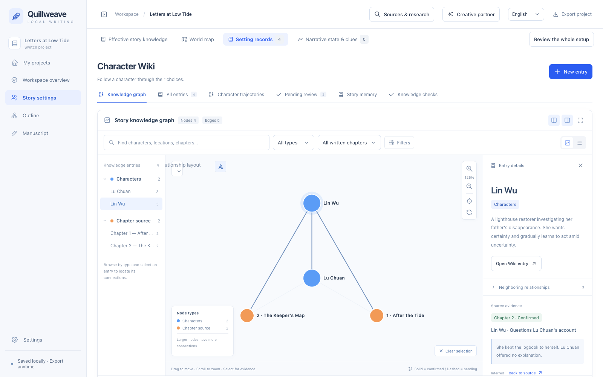
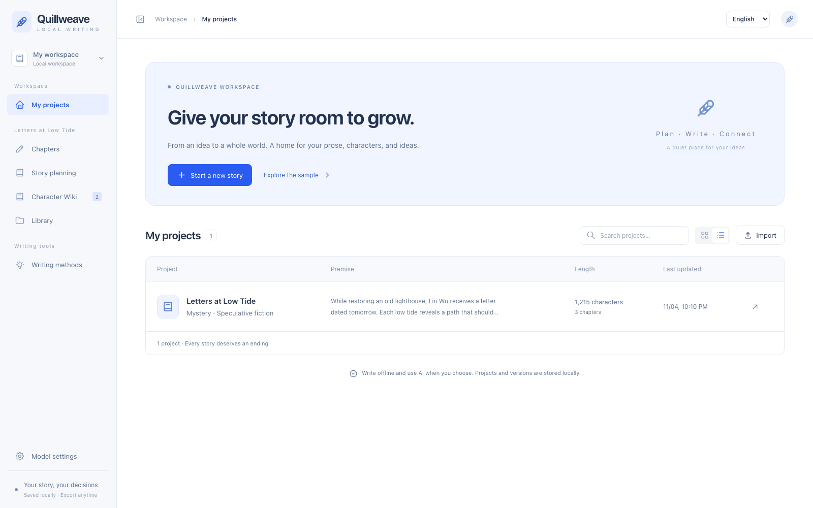
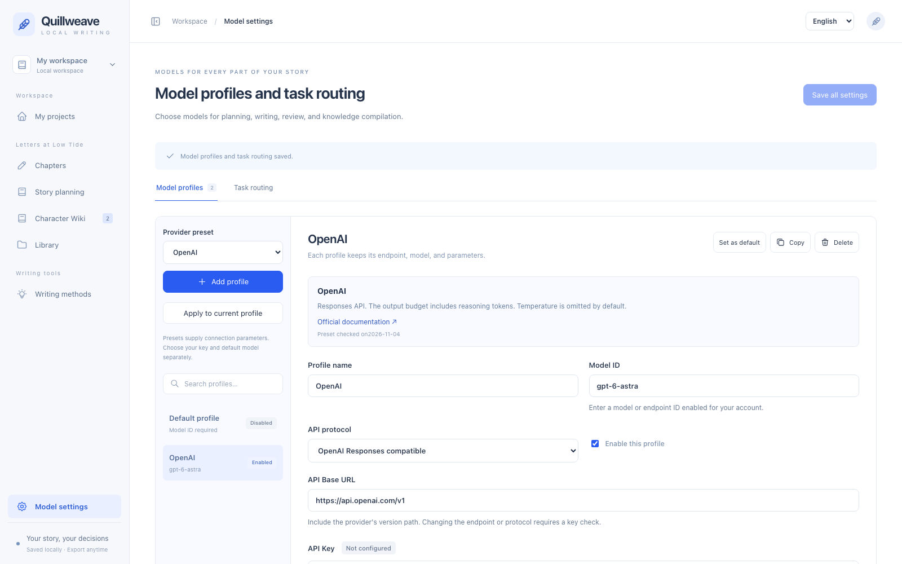

# Quillweave

A local fiction-writing workspace with AI story planning, chapter editing, a source-linked Character Wiki, and an interactive knowledge graph.

Quillweave uses Go, Wails 3, React, and TypeScript. The interface supports English and Simplified Chinese, with English selected by default.

[Download releases](https://github.com/zanw1/Quillweave/releases) · [Build from source](#build-from-source) · [Publish a release](#publish-a-release) · [MIT license](LICENSE)

## What you can do

- Write chapters offline, set chapter length goals, and restore earlier versions.
- Switch between stories explicitly; project tools opened from home ask which story to use when several exist.
- Delete a story with confirmation, including its saved versions, knowledge, and AI history. Export a backup first to retain a copy.
- Generate prose with fiction-specific style guidance or use Humanize chapter to request a language edit, then review it before replacing the draft.
- Develop an idea in a persistent conversation, choose serial or traditional fiction goals, and move into planning when you decide.
- Plan volumes, units, chapters, and scenes with character goals, conflicts, consequences, length budgets, and clue tracking.
- Use an agent to recall context, research, plan, and delegate scoped writing or review; inspect each proposed change before accepting it.
- Rename conversations, branch from earlier questions, regenerate answers, recover interrupted prose, and retain drafts across navigation.
- Maintain characters, places, factions, items, relationships, and clues with quotes linked to their source passages.
- Explore a knowledge graph, filter by chapter or entry type, and inspect the evidence behind a connection.
- Compile source evidence into story memory, review the proposed knowledge, and check for stale sources or unresolved relationships.
- Track world rules, character state, knowledge boundaries, reader promises, and foreshadowing with source quotes and chapter ranges.
- Configure web research with attributable excerpts, optionally connect Hindsight, and compare author-scored exploration policies in a replay lab.
- Assign independent model profiles to planning, writing, review, Wiki extraction, and memory compilation.
- Import older Quillweave projects and UTF-8 TXT or Markdown sources, and export Markdown or a complete JSON project backup.

## Interface

These screenshots show the built-in **Letters at Low Tide** sample. Its story and demonstration evidence are supplied with the app. Model settings show a credential-free example configuration.

### Chapter writing

Chapter navigation, the prose editor, version controls, and a writing assistant share one workspace.



### Story knowledge graph

Select a character or connection to inspect its description, related entries, and quoted evidence. Solid and dashed relationships distinguish confirmed and pending evidence.



<details>
<summary>Project home and model settings</summary>

### Project home

Open a project, import an older work, or explore the built-in sample.



### Model settings

Choose a provider preset, edit its endpoint and model, and assign profiles to individual tasks.



</details>

## Download and run

Open [Releases](https://github.com/zanw1/Quillweave/releases) and choose the download for your platform.

| Platform | Primary download | Requirements |
|---|---|---|
| macOS Apple Silicon | `Quillweave-<version>-macos-arm64.dmg` | macOS 13 or later |
| Windows x64 | `Quillweave-<version>-windows-amd64.exe` | Windows 10/11 and [Microsoft Edge WebView2 Runtime](https://developer.microsoft.com/en-us/microsoft-edge/webview2) |

On Windows, download the EXE and open it directly. On macOS, open the DMG and drag `Quillweave.app` to the Applications shortcut. A macOS `.app` is a bundle directory, so the disk image carries its complete structure in one downloadable file.

Optional ZIP packages are also available. The DMG and ZIP packages include the project license and third-party notices. The standalone Windows EXE embeds those notices as resources. `LICENSE.txt`, `THIRD_PARTY_NOTICES.txt`, and `SHA256SUMS.txt` are also attached to the release.

The current desktop packages are preview builds. macOS uses ad-hoc signing. Developer ID signing and Apple notarization are pending. For first-run approval of a downloaded preview, follow [Apple's app-opening instructions](https://support.apple.com/en-us/102445). Local Windows package verification covers cross-compilation. The release workflow is configured to build on a Windows runner, with interactive Windows acceptance still pending. Linux builds require their own GTK/WebKit toolchain.

## First steps

1. Open the sample, or select **Start a new story**. A working title is optional; leave it blank to create an untitled workspace.
2. An unplanned project opens the creative studio. Begin with any idea, then use **Story goals** to choose a writing form, language, length, chapter count, audience, pacing, and naming preferences. An undecided story's initial discussion does not impose chapter-length or viewpoint defaults.
3. Write offline, or open **Model settings** to add a provider preset, enter an API key when required by the provider, and choose a default model or task-specific profiles. Local Ollama can use an empty key.
4. Discuss and accept useful suggestions. Choose **Start planning** when ready, create or review volume/unit/chapter/scene plans, and materialize confirmed chapter plans into drafts. Existing chapter text is retained.
5. Write, review, and request memory updates from a chapter. Accept proposed knowledge after checking its quotes; **Compile Wiki** retains the existing evidence-compilation workflow. The studio shares those sources and confirmed memory with later requests.

Use the language selector in the top bar to switch between **English** and **中文**. The selection is saved for this browser or desktop WebView. Switching languages retains the current page and unsaved drafts. AI output follows an explicit task language, then the work's chosen language, then the interface language. New works follow the interface by default. Chinese tasks use Chinese creative instructions while preserving source quotes.

Press **Enter** to send and **Shift+Enter** for a new line; IME composition does not submit. Successful submission clears the sent draft without deleting newer input. Rewind and regeneration create branches; accepted manuscript changes are restored through chapter versions.

AI replies use Streamdown with CJK support for streamed Markdown, including headings, lists, quotes, tables, and code blocks. Completed history uses static rendering; interrupted output retains incomplete-Markdown handling. Copying or applying a reply uses its original Markdown source. Remote image references open only after an author action. Mathematical typesetting and Mermaid rendering plugins are not enabled.

### Models and privacy

Model profiles separate the actual service provider from the template used to add a new profile. **Fetch models** uses the current connection and API-key draft without saving it; text-model results can be searched and selected, and manual model IDs remain supported. Discovery uses native model-list endpoints for OpenAI-compatible APIs, Anthropic, Gemini, and Ollama. Some services do not expose a model list; use their model or deployment ID in that case.

Model token capacities are displayed separately from the local context character budget. Known output limits are enforced per model; custom deployments can override them. The character budget controls local story-context assembly and is not a token count. The service enforces its real context window. Output budgets include reasoning where the provider counts it. Application resource guards remain independent of advertised model capacities.

Portable model metadata is bundled from the MIT-licensed `@cherrystudio/provider-registry` version `0.3.5`, retaining its copyright notice in [LICENSE](LICENSE). It is metadata, not proof that a model is enabled for an account or supported by an adapter. No Cherry Studio desktop code or Node runtime is required. Refresh the pinned snapshot with `python3 scripts/update_model_catalog.py --version <exact-version>`; the updater verifies archive integrity and the package's actual MIT license before replacing the data.

The preset catalog covers OpenAI, Anthropic, Google Gemini, DeepSeek, Alibaba Cloud Bailian, Volcengine Ark, Zhipu, Moonshot/Kimi, MiniMax, xAI, local Ollama, and OpenRouter. Selecting a provider fills the profile name, Base URL, protocol, example model, and provider options together. Duplicate names receive a numeric suffix. OpenRouter defaults to `https://openrouter.ai/api/v1` and retains complete `provider/model` IDs when listing or requesting models. The app supports Chat Completions, Responses, Anthropic Messages, Gemini Interactions, Gemini Generate Content, and Ollama Chat.

Model selection follows **project override → global task route → default profile**. Wiki extraction and memory compilation can use different models. Connection tests send a short request and may incur provider charges.

API keys are held in the current app process. Enter them again after restart. `QUILLWEAVE_API_KEY` can supply the default profile's key at startup. Persistent settings and exported project archives redact credentials. AI requests send the selected story context to the configured provider. Some protocols also retain private continuation context locally for compatible follow-up requests.

### Story knowledge

Wiki compilation extracts evidence from the complete source in chunks, then compiles story memory in a second stage. Both stages must succeed before publication to the local project. Evidence and memory have separate author review decisions. Changes to the source, tracking focus, models, or evidence determine cache reuse and knowledge freshness.

A matching quote establishes that a passage exists. Authors review the interpretation, entity attribution, and narrative meaning.

The studio distinguishes author settings, plans, source facts, and inferences. Confirmed memory carries chapter validity, character knowledge, and payoff deadlines. Source edits mark derived evidence stale. Local checks flag overdue clues and possible continuity issues; a mention of a deceased character still needs review for flashbacks or references.

### Research and experiments

Open **Research → Search and memory integrations** to enable research and configure providers. Supported adapters are Tavily, Bocha, Exa, Serper, SearXNG, and Wikipedia. Wikipedia can work without a key; a SearXNG instance needs JSON output enabled. Other services may require credentials or have account-specific limits. Search is disabled until enabled. Results retain a URL, title, excerpt, retrieval time, and provider; accepting a result adds a source for later discussion and review.

Hindsight is optional. Configure an endpoint and explicitly choose confirmed memories to send; recall and reflect use separate story/branch banks. External responses remain reference material. Integration keys are process-only, like model keys. Restarting requires entering them again.

The replay lab borrows the discovery-history idea from [Dream-RSI](https://github.com/google-research/dream-rsi). It compares bounded exploration orders using frozen, author-scored cases, training/held-out splits, and cost penalties. It does not run the official policy-code evolution framework or change production prompts or model weights. Passing its replay threshold is not evidence of improved literary quality.

### Storage and backups

Chapters and knowledge records are saved incrementally in SQLite with local full-text retrieval. Before upgrading an existing pre-studio database, the app keeps a recovery copy beside it named `<database>.before-studio.sqlite3`, then migrates in a transaction. Retain that copy when testing a downgrade.

Complete JSON backups include conversations, branches, public task/proposal records, and experiments, while excluding credentials and private model continuation state. Imported backups receive new runtime IDs so they do not overwrite the original work. Current local retrieval uses text matching and structured memory ranking rather than bundled embedding models.

Full backups use bounded file transfers while keeping the `quillweave-1` JSON format. The supported limits are 4 GiB per archive and 256 MiB per record. Desktop saves stream directly to a file; browser streaming requires File System Access support, with a 128 MiB compatibility-download limit in other browsers. The legacy single-command JSON interface remains limited to 40 MB; the app's file import supports larger archives. Interrupted uploads are discarded without publishing a partial work, and completion retries reuse the same restored work.

## Build from source

Use Go 1.27 or later and Node.js 22 or later. Native macOS builds also require Xcode Command Line Tools. Windows runtime requires WebView2.

```sh
git clone https://github.com/zanw1/Quillweave.git
cd Quillweave
npm ci
npm run desktop
```

The desktop development command builds frontend assets, starts Vite, and restarts the Go window after backend edits.

For a browser preview, run the following commands and open `http://127.0.0.1:1421`.

```sh
npm run build
npm run backend
```

For frontend hot reload, run `npm run dev` in another terminal and open `http://127.0.0.1:1420`.

### Checks and local packages

```sh
npm run check
npm run check:test-layout
npm test
npm run test:core
npm run test:race
npm run check:go
npm run test:ui
npm run test:midscene
npm run bundle
npm run bundle:windows
```

All maintained tests and fixtures live in [test/](test/README.md), grouped by backend responsibility and frontend acceptance. The backend runner uses temporary Go overlays to preserve package-private tests; `go test ./...` remains a working entry. Use `node test/run.mjs core --case TestName` for a single case. `check:test-layout` prevents scattered or numbered suites, and `check:go` also vets the relocated test sources.

`test:ui` uses Python 3, a locally available Chrome browser, and a pinned Playwright CLI obtained through npm. It runs the real Go service with local model/search/memory fixtures, then removes its browser, services, temporary database, cache, and screenshots on success or failure. It does not use a cloud account. `test:midscene` additionally uses a configured vision model or authenticated Codex CLI. Maintained code files, including active tests, are limited to 1,000 lines by `check:size` and release CI.

The implementation map, design decisions, and acceptance evidence are in [aidd-wiki](aidd-wiki/index.md).

Native applications are written to `build/bin/`. To create the DMG, standalone Windows EXE, optional ZIP packages, and checksums, run these commands on macOS.

```sh
npm run release -- darwin arm64
npm run release -- windows amd64
```

On Windows, run `npm run release -- windows amd64`. macOS applications are built on macOS. Release files are written to `build/releases/`. Temporary packaging files are cleaned on success or failure.

## Publish a release

<details>
<summary>First-time GitHub repository setup</summary>

After reviewing the license and files selected for publication, run the following commands from the project root with GitHub CLI signed in to the repository owner account.

```sh
git init -b main
git add .
git diff --cached --stat
git commit -m "Initial open-source release"
gh repo create zanw1/Quillweave --public --source=. --remote=origin --push
```

</details>

The release workflow builds macOS arm64 and Windows amd64 packages after a version tag is pushed. It runs the configured checks, creates the DMG and standalone EXE, calculates SHA-256 checksums, and creates a **draft prerelease** with these files, optional ZIP packages, and license notices attached.

The tag must match `package.json`. The current version uses `v3.1.2`.

```sh
git tag -a v3.1.2 -m "Quillweave v3.1.2"
git push origin v3.1.2
```

Open the repository's **Actions** tab and wait for **Build release** to finish. Open **Releases**, review the draft's notes and assets, test the downloaded applications, and select **Publish release**. A workflow rerun can replace assets on the draft. Published releases require a new version.

For subsequent versions, update the root and frontend package versions and the lockfile together. Refresh `THIRD_PARTY_NOTICES.txt` when dependencies change, commit the reviewed changes, and push the matching version tag. The workflow uses the repository's automatically supplied `GITHUB_TOKEN` with release-write permission confined to the final upload job. [GitHub release documentation](https://docs.github.com/en/repositories/releasing-projects-on-github/managing-releases-in-a-repository)

Git ignores `build/bin/`, `build/releases/`, `data/`, `node_modules/`, `frontend/dist/`, `.env`, `.env.*`, and `参考/`. The `.env.example` template is allowed. Review staged files before pushing, including any manuscripts or exported backups saved elsewhere. Commit source, manifests, license notices, the workflow, and the README screenshots.

### Story management and prose acceptance

Use disposable projects and a local streaming mock for workflow checks. Real-model prose quality still requires human review.

| Input or check | Expected result |
|---|---|
| Open a project tool with no stories | Show the new-story dialog |
| Open a project tool with one story | Enter that story and the requested tool |
| Open a project tool with several stories | Ask which story to use and retain the requested tool |
| Switch stories inside Character Wiki | Change stories while staying in Character Wiki |
| Cancel deletion or press Escape | Retain the complete story |
| Delete a story with a running AI task | Reject deletion until the task finishes |
| Edit a story after opening its delete confirmation | Reject the stale confirmation and retain the newer revision |
| Simulate a database failure during deletion | Roll back the story and its AI history together |
| Delete one of two stories, then the last story | Retain the other story and its drafts; clear selection after deleting the current story |
| Humanize an empty or unsaved chapter | Disable empty drafts; save source prose before generating; require explicit application and reject results after source edits |

### Release acceptance

| Input or check | Expected result |
|---|---|
| Clean checkout and `npm ci` | Dependencies install from the lockfile |
| `npm run build` | Production frontend is available for Go embedding |
| Type checks, Go tests, and vet | All configured checks pass |
| macOS arm64 packaging | DMG contains the signed app, Applications shortcut, and license notices, with a ZIP also provided |
| Windows amd64 packaging | Standalone GUI EXE embeds license notices, with a ZIP also provided |
| `SHA256SUMS.txt` verification | Every listed release file matches its digest |
| Tag differs from the package version | Packaging stops before building |
| A platform build fails | Draft release job waits for both successful builds |
| Rerun an existing draft tag | Draft assets are replaced with the successful build |
| Rerun a published tag | Existing published assets are protected |

## Project structure

```text
frontend/               React interface, language pack, embedded assets
internal/core/          Models, SQLite storage, AI jobs, Wiki, graph
internal/desktop/       Wails command bridge and native file dialogs
internal/preview/       Loopback HTTP service
internal/platform/      Desktop data locations
cmd/                    Desktop, preview, and Windows resource entry points
scripts/                Development, build, and release packaging
test/                   Backend modules, frontend acceptance, fixtures, archives
docs/images/            README screenshots
.github/workflows/      Release automation
```

## Local data and backups

Desktop data uses the identifier `studio.quillweave.desktop`. macOS stores projects in `~/Library/Application Support/studio.quillweave.desktop/quillweave.sqlite3`. Windows uses Roaming AppData, and Linux uses its XDG data location. Browser preview defaults to `data/preview/`. `QUILLWEAVE_DATA_DIR` and `QUILLWEAVE_PORT` override the preview data directory and port.

Complete project backups retain prose, setup, evidence, versions, writing parameters, project model references, saved conversations, public AI tasks/proposals, and experiments. Global model profiles, credentials, private model continuation state, and unsaved editor text are excluded. Older project imports receive compatible field defaults.

Chapter targets use non-whitespace Unicode characters. Context budgets use Unicode characters, and provider output budgets use tokens. The historical `*_words` JSON field names retain their established character-count unit.

## Acknowledgments and license

The embedded Wiki draws on the source-preserving knowledge-maintenance ideas in [nashsu/llm_wiki](https://github.com/nashsu/llm_wiki). The writing-method cards include links to their original sources.

Quillweave is released under the [MIT License](LICENSE). Dependency copyright and license texts are collected in [THIRD_PARTY_NOTICES.txt](THIRD_PARTY_NOTICES.txt) and included in packaged releases.
